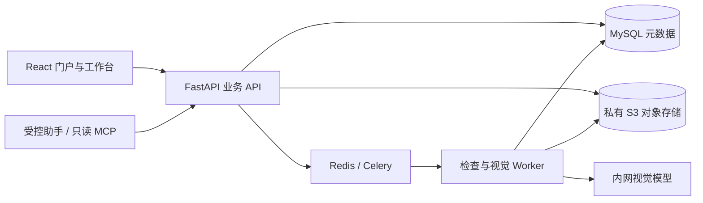

# 高质量图像数据治理平台与 Agent 助手

Image Dataset Governance & Controlled Agent

面向图像训练数据生产的治理平台：**批量接入 → 检查与去重 → 视觉预标注 → 人工独立复核 → 版本发布 → 授权交付**。


[](https://github.com/pite12704-netizen/dataset-platform-governance/actions/workflows/ci.yml)

采用 FastAPI、MySQL、Redis/Celery、S3 兼容存储及 React/TypeScript。Agent 通过受控业务接口帮助诊断流程、预览识别/去重计划，人工确认后创建任务。项目定位为可运行、可学习的工程实现，不代表已通过企业生产容量或模型准确率认证。

## 快速阅读

这是一个平台，包含数据治理与 Agent 两个阅读方向，共用身份、版本、任务及审计。
简历中可分别介绍两个模块；代码和验收边界可以从下列入口核对。

- **后端与数据治理**：先看 [架构与一致性](docs/public/architecture.md)，再追 [上传](backend/app/uploads.py)、[任务派发](backend/app/dispatching.py)、[连续复核](backend/app/review_workbench.py) 和 [授权交付](backend/app/delivery.py)。
- **Agent 应用**：看 [LangGraph 人工确认与恢复](docs/langgraph-workflow-learning-guide.md)、[本地模型 Schema 决策](docs/agent-local-model-protocol.md)，对应 [图编排](backend/app/agent_graph.py)、[检查点](backend/app/agent_graph_store.py) 和 [工具运行时](backend/app/agent_runtime.py)。
- **检索与 RAG**：看 [多模态检索指南](docs/retrieval-learning-guide.md)，对应 [BM25](backend/app/bm25.py)、[混合检索与权限](backend/app/retrieval_service.py)、[事务索引事件](backend/app/retrieval_events.py) 和 [独立编码服务](services/retrieval_encoder/server.py)。
- **动手验证**：按 [项目阅读与演示路线](docs/project-tour.md) 运行空白学习环境；完整代码导航见 [CODE_STUDY_GUIDE](CODE_STUDY_GUIDE.md)。

## 核心能力

- **数据接入**：网页文件夹、客户端 MySQL/MinIO 导出、固定清单、分片续传、SHA-256校验、配额及隔离检查。
- **数据治理**：重复候选、版本与血缘、不可覆盖的发布快照；原图保留，训练包按批准依据交付。
- **协作复核**：人物或自定义目标模板、整图补漏、领取租约和 revision、标注与复核分账号、同屏重复候选对照。
- **权限与发布**：组织/项目隔离、版本级授权、许可确认、管理员发布审批、到期与撤销、审计记录。
- **受控 Agent**：结构化参数、输入/模板/模型指纹、持久确认单、CAS与幂等键、视觉分片计划、SSE进度及重新鉴权。
- **LangGraph**：`StateGraph`、`interrupt/Command`、SQL 检查点与执行租约，支持人工确认和中断恢复；Celery 继续执行耗时任务。
- **检索与记忆**：字段加权 BM25、BGE-M3 文本向量、Qdrant、RRF 融合、带引用的知识问答；Chinese-CLIP 图片相似检索；有界会话需求摘要。
- **本地模型工具决策**：原生协议与 Schema 单步决策协议可选，工具白名单、参数/证据/授权复核、循环预算及真实模型留出门禁。
- **交付**：COCO、YOLO、审核JSON、VLM JSONL；MySQL元数据与私有对象存储解耦。

## 本地体验：无需真实模型

需要 Python 3.12、Node.js 22。先克隆公开源码：

```bash
git clone https://github.com/pite12704-netizen/dataset-platform-governance.git
cd dataset-platform-governance
```

以下命令不需要 Docker、真实模型或已有数据库。请在**新克隆目录**运行：

```bash
python -m venv .venv
# Linux/macOS
.venv/bin/python -m pip install --require-hashes -r backend/requirements.lock
# Windows 对应：.venv\Scripts\python.exe -m pip install --require-hashes -r backend/requirements.lock
npm --prefix frontend ci
npm --prefix frontend run build
.venv/bin/python scripts/start_public_sandbox.py
# Windows 对应：.venv\Scripts\python.exe scripts/start_public_sandbox.py
```

打开 **http://127.0.0.1:18080/**，自行注册账号。每次启动分配新的 `var/sandboxes/` 空命名空间；没有默认管理员或共享密码，不连接维护者电脑，不读取现有部署配置。学习环境使用 SQLite、本地文件和开发检查，模型默认关闭；它用于代码/UI体验，不能对外提供生产服务。

完整的 MySQL、对象存储、Redis、Worker、扫描和 HTTPS 部署见 [部署边界与配置](docs/public/deployment.md)。业务平台并未因此切换为SQLite实现。

使用 `scripts/start_public_sandbox.py --langgraph` 可体验固定的人工确认流程，无需模型。
RAG/图片检索需要独立编码器和 Qdrant，自主工具调用需要本地模型及匹配的门禁报告；公开克隆默认关闭这些外部能力。
配置示例在 [config/examples](config/examples)；源码不包含运行密钥、实模型报告或模型权重。

## 架构与代码



从 [架构及任务一致性](docs/public/architecture.md) 和 [代码入口](CODE_STUDY_GUIDE.md) 开始。后端在 `backend/app`，前端在 `frontend/src`，迁移在 `backend/migrations`，客户接入工具在 `clients/ingest`。

## 本地检查与 CI

```bash
bash scripts/setup-cloud.sh
bash scripts/check-cloud.sh
python scripts/audit_repository.py
python scripts/audit_git_history.py
python scripts/public_release.py check
```

Windows 可使用虚拟环境运行相同 pytest、ruff 与 npm 命令。普通检查不连接维护者的 MySQL/Redis/MinIO/模型；需要真实服务的测试默认跳过，应通过专门脚本创建临时容器后再验证。CI不能替代目标环境的负载和恢复验收。

回归用例覆盖参数/授权隔离、并发确认、过期与撤销、提交后中断、索引事件回放及检索回退。
本地实模型的合成门禁与自动化契约测试分别记录，数字不用于宣称业务图片准确率或线上吞吐。

## 已知边界

- 视觉输出是候选，必须人工复核；工程契约测试不证明真实服饰识别准确率。
- 原生 Tool Calling 模块可选，生产启用需要与模型及提示版本匹配的实模型证据；默认受控入口不等于完全自主 Agent。
- 自定义框和属性不代表已实现 OCR、分割、任意属性认证；SSE恢复当前快照，不承诺完整事件回放。
- 容量限制是保护配置，不是PB规模、万人并发或吞吐保证。没有集群高可用和数据库故障自动切主承诺。
- 正式环境必须选择维护中的服务发行版，配置TLS、邮件/身份、存储备份、扫描、监控与容量预算。

## 参与与许可

请阅读 [贡献指南](CONTRIBUTING.md)、[安全报告](SECURITY.md)、[第三方说明](THIRD_PARTY_NOTICES.md)。项目自身代码采用 [MIT](LICENSE)；数据集、模型权重、容器和依赖保留各自许可。仓库不附带真实数据、模型权重或账号凭据。

维护者公开前请按 [发布清单](docs/public/github-publication.md) 创建干净候选源码，不直接推送带本机历史的工作目录。
